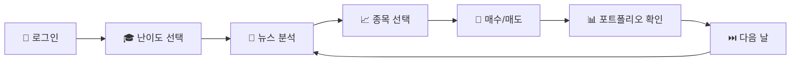
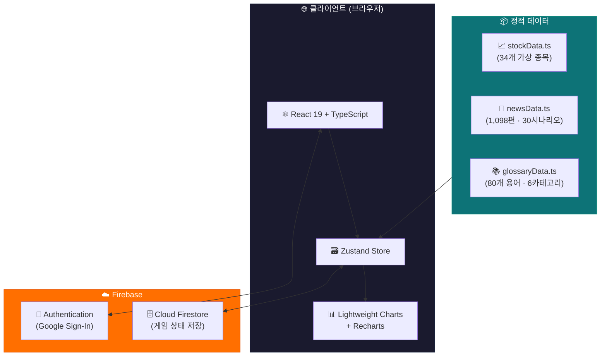
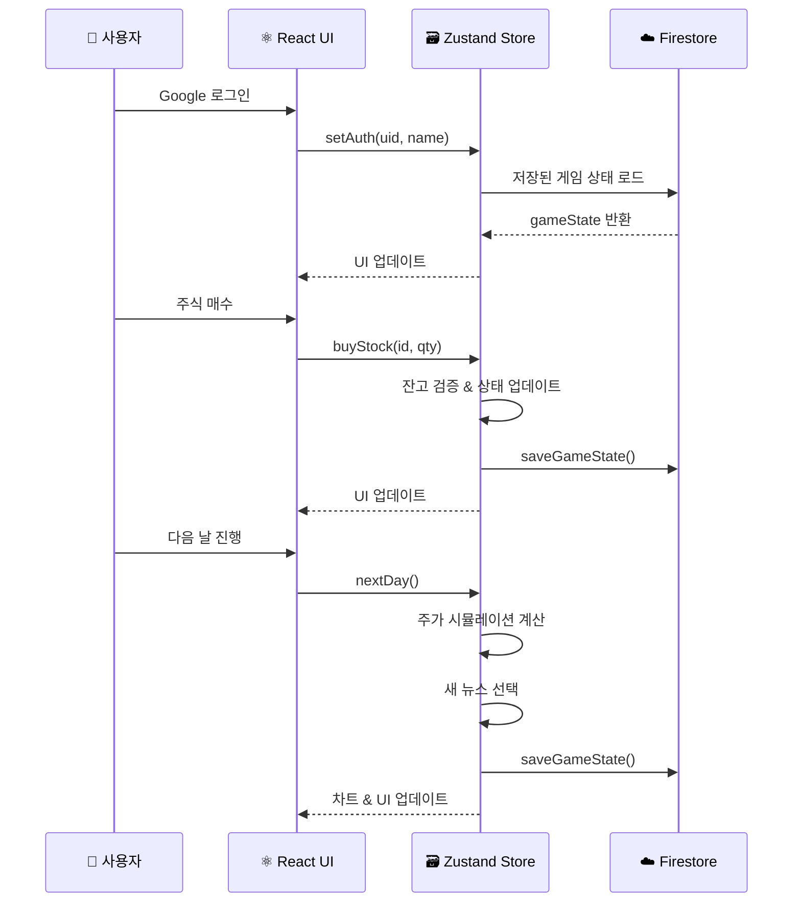

<div align="center">

# 📈 스탁스쿨 (StockSchool)

### 실전 금융투자 교육 시뮬레이터

<p align="center">
  <strong>학생들을 위한 게임형 모의 주식 투자 플랫폼</strong><br/>
  뉴스를 분석하고, 주식을 사고팔며, 투자의 세계를 안전하게 경험하세요!
</p>

<p align="center">
  
  
  
  
  
</p>

<p align="center">
  
  
  
  
</p>

---

[📋 소개](#-프로젝트-소개) •
[✨ 기능](#-주요-기능) •
[🏗️ 기술 스택](#️-기술-스택) •
[🚀 시작하기](#-시작하기) •
[🎮 게임 가이드](#-게임-플레이-가이드) •
[📊 아키텍처](#-시스템-아키텍처) •
[📖 문서](#-문서) •
[🤝 기여하기](#-기여하기)

</div>

---

## 📋 프로젝트 소개

**스탁스쿨(StockSchool)** 은 초등학생부터 고등학생까지, **100% 가상 기업과 가상 경제 뉴스**를 기반으로 투자의 원리와 분산투자를 안전하게 배울 수 있는 **비영리 금융 문해력 교육 시뮬레이터**입니다.

> 💡 *"실제 돈 없이, 개인정보 걱정 없이, 안전하게 배우는 주식 투자 교실"*

학생들은 매일 가상 경제 뉴스를 분석하고, 17개 산업 섹터의 34개 가상 기업 모의 주식을 사고팔며, 포트폴리오를 점검하는 과정에서 **자연스럽게 금융 리터러시**를 키울 수 있습니다.

### 🎯 왜 스탁스쿨인가?

| 특징 | 설명 |
|:---:|:---|
| 🛡️ **아동·학생 개인정보 보호** | 개인정보를 서버로 전송하지 않는 **게스트(로컬) 모드** 기본 제공 + Google 로그인 시 연령/보호자 동의 게이트 및 회원 탈퇴·파기 지원 |
| 🎓 **난이도 맞춤** | 초등·중등·고등 3단계 난이도별 눈높이 해설과 차등 시뮬레이션 엔진 |
| 🏢 **34개 가상 기업 (17개 섹터)** | 상표권·명예훼손·브랜드 편향을 없앤 창작 가상 기업(수출형/내수형 구분 포함) |
| 📰 **1,098편 가상 뉴스 & 30종 시나리오** | 6종 기사 포맷·핵심 수치·인용구·관련 산업 비공개 추론(1단계 산업 선택 + 2단계 방향 예측)으로 경제 문해력 훈련 |
| 📊 **전문가 차트** | TradingView Lightweight Charts 기반 주가 및 변동 연동 거래량 차트 |
| 📚 **금융 용어 사전** | 6개 카테고리 **80개 핵심 금융 용어**(HBM·SCFI·부동산 PF·유상증자·밸류에이션 등)의 눈높이별 해설·실전 예시·연관 용어 꼬리물기 및 1,098편 기사 즉시 연동 |
| 🌙 **다크 모드** | 눈이 편한 다크/라이트 테마 지원 |

---

## ✨ 주요 기능

### 🏫 3단계 난이도 시스템

```
🟢 초급 학교 (Elementary)    → 가상 자금 100만원  | 일상 비유 & 높은 뉴스 인과관계
🟡 중급 아카데미 (Middle)    → 가상 자금 500만원  | 산업·공급망 분석 & 시장 변동성
🔴 고급 연구소 (High)        → 가상 자금 1,000만원 | 거시·환노출도 복합 분석 & 이월 모멘텀
```

### 📈 핵심 기능 목록

- 🛡️ **게스트 모드(개인정보 비수집) & 선택적 Google 로그인** — 만 14세 미만 학생도 보호자 동의 부담 없이 즉시 학습 가능
- ⚖️ **법적 고지 및 데이터 주권** — 교육용 면책 고지, 아동 친화 개인정보처리방침(국외이전 고지 포함), 이용약관, 오픈소스 고지(TradingView NOTICE 포함), 원클릭 회원 탈퇴·데이터 파기
- 💹 **난이도별 주가 시뮬레이션 (`priceEngine.ts`)** — 뉴스 반영·시나리오 `marketBias`·KRX 호가 단위 반올림·수출/내수 환율 차별화·결정론적 거래량·돌발 수급 사유 표시
- 🛒 **모의 매수/매도 거래 & ★ 관심 종목** — 평균 매수가 자동 계산, 수량 조절, 잔고 검증, 학생 주도 관심 종목 찜하기
- 📊 **포트폴리오 관리 & 이중 적중률 리포트** — 보유 종목, 수익률, 자산 추이 차트, 섹터 비중 파이차트, 방향 예측 + 산업 추론 누적 적중률
- 📰 **무스포일러 경제 문해력 뉴스룸** — 매일 3건(6종 기사 포맷·핵심 수치·인용구), 당일 관련 산업/종목 비공개 → 스스로 산업·방향 2단계 추론 → 다음 날 실제 결과 & 스탁 쌤 해설 공개
- 📖 **금융 용어 사전 (80개)** — 6개 카테고리(주식 기초·재무·차트·거시·산업 지표·심화) 80개 핵심 용어의 눈높이별 해설·실전 예시·연관 용어 꼬리물기 및 기사 본문 연동
- 📋 **모의 호가창 (참고용)** — KRX 가격대별 호가 단위를 반영한 학습용 호가 시각화
- 🏢 **기업 정보 패널** — 가상 기업별 사업 구조(수출형/내수형) 및 난이도 맞춤 분석
- 🎓 **인터랙티브 튜토리얼** — 9단계 온보딩으로 초보자도 쉽게 시작
- 🌗 **다크/라이트 테마** — 한 번의 클릭으로 테마 전환

---

## 🏗️ 기술 스택

<table>
<tr>
<td align="center" width="25%">

**🎨 프론트엔드**

</td>
<td align="center" width="25%">

**🗄️ 백엔드 서비스**

</td>
<td align="center" width="25%">

**📊 차트 & UI**

</td>
<td align="center" width="25%">

**🔧 개발 도구**

</td>
</tr>
<tr>
<td>


</td>
<td>


</td>
<td>


</td>
<td>


</td>
</tr>
</table>

---

## 📁 프로젝트 구조

```
📦 모의주식/
├── 📄 index.html                    # HTML 진입점
├── 📄 package.json                  # 프로젝트 설정 & 의존성
├── 📄 vite.config.ts                # Vite 빌드 설정
├── 📄 tailwind.config.js            # TailwindCSS 설정
├── 📄 tsconfig.json                 # TypeScript 설정
├── 📄 .gitignore                    # Git 제외 파일
│
├── 📂 public/                       # 정적 파일
│   ├── 🎨 favicon.svg               # 파비콘
│   └── 🎨 icons.svg                 # SVG 아이콘 스프라이트
│
├── 📂 src/                          # 소스 코드
│   ├── 📄 main.tsx                  # React 진입점
│   ├── 📄 App.tsx                   # 루트 컴포넌트 (인증 & 라우팅)
│   ├── 🎨 App.css                   # 앱 전역 스타일
│   ├── 🎨 index.css                 # CSS 변수 & 기본 스타일
│   │
│   ├── 📂 assets/                   # 이미지 & 미디어 자산
│   │
│   ├── 📂 components/               # React 컴포넌트
│   │   ├── 📂 layout/               # 레이아웃 컴포넌트
│   │   │   ├── AppShell.tsx         #   메인 앱 레이아웃
│   │   │   ├── Header.tsx           #   상단 헤더 바
│   │   │   └── SchoolLogo.tsx       #   학교 로고 SVG
│   │   │
│   │   ├── 📂 trading/              # 트레이딩 컴포넌트
│   │   │   ├── StockList.tsx        #   종목 리스트 (검색/필터)
│   │   │   ├── PriceChart.tsx       #   가격 차트 (TradingView)
│   │   │   ├── OrderPanel.tsx       #   매수/매도 주문 패널
│   │   │   ├── OrderBook.tsx        #   호가창
│   │   │   ├── PortfolioPanel.tsx   #   포트폴리오 대시보드
│   │   │   ├── NewsPanel.tsx        #   뉴스 패널
│   │   │   ├── CompanyInfoPanel.tsx #   기업 정보 패널
│   │   │   ├── GlossaryHub.tsx      #   금융 용어 사전
│   │   │   └── TutorialGuide.tsx    #   튜토리얼 가이드
│   │   │
│   │   └── 📂 ui/                   # 기초 UI 컴포넌트 (shadcn/ui)
│   │       ├── button.tsx, card.tsx, dialog.tsx, input.tsx,
│   │       ├── label.tsx, scroll-area.tsx, sheet.tsx,
│   │       ├── sonner.tsx, table.tsx, tabs.tsx
│   │
│   ├── 📂 lib/                      # 유틸리티 & 데이터
│   │   ├── firebase.ts              #   Firebase 초기화
│   │   ├── priceEngine.ts           #   난이도별 주가·뉴스·채점 엔진
│   │   ├── stockData.ts             #   34개 가상 종목 (17개 섹터)
│   │   ├── newsData.ts              #   1,098편 가상 뉴스 · 30종 시나리오 통합
│   │   ├── glossaryData.ts          #   80개 금융 용어 사전 통합 진입점
│   │   ├── glossary/                #   6개 카테고리 용어 모듈 및 기사 자동 매칭기
│   │   └── utils.ts                 #   유틸리티 함수
│   │
│   ├── 📂 pages/                    # 페이지 컴포넌트
│   │   ├── Login.tsx                #   로그인 & 난이도 선택
│   │   └── Dashboard.tsx            #   메인 대시보드
│   │
│   └── 📂 stores/                   # 상태 관리
│       └── gameStore.ts             #   Zustand 게임 스토어
│
└── 📂 docs/                         # 프로젝트 문서
    ├── ARCHITECTURE.md              #   시스템 아키텍처
    ├── TECH_STACK.md                #   기술 스택 상세
    ├── COMPONENT_GUIDE.md           #   컴포넌트 가이드
    ├── GAME_MECHANICS.md            #   게임 메카닉스
    ├── DATA_MODELS.md               #   데이터 모델
    ├── API_REFERENCE.md             #   API 레퍼런스
    ├── DESIGN_SYSTEM.md             #   디자인 시스템
    ├── SETUP_GUIDE.md               #   설치 가이드
    ├── DEPLOYMENT.md                #   배포 가이드
    ├── CONTRIBUTING.md              #   기여 가이드
    ├── CODE_OF_CONDUCT.md           #   행동 강령
    ├── SECURITY.md                  #   보안 정책
    ├── CHANGELOG.md                 #   변경 이력
    └── ROADMAP.md                   #   로드맵
```

---

## 🚀 시작하기

### 📋 사전 요구사항

| 도구 | 최소 버전 | 권장 버전 |
|:---:|:---:|:---:|
| Node.js | 18.0+ | 20 LTS |
| npm | 9.0+ | 10+ |
| Git | 2.30+ | 최신 |

### ⚡ 빠른 시작

```bash
# 1. 저장소 클론
git clone https://github.com/your-username/stock-school.git
cd stock-school

# 2. 의존성 설치
npm install

# 3. 개발 서버 실행
npm run dev
```

> 🌐 브라우저에서 `http://localhost:5173` 접속

### 🔥 Firebase 설정

Firebase 프로젝트를 직접 구성하려면 [📖 Setup Guide](./docs/SETUP_GUIDE.md)를 참조하세요.

```typescript
// src/lib/firebase.ts 에 Firebase 설정값 입력
const firebaseConfig = {
  apiKey: "YOUR_API_KEY",
  authDomain: "YOUR_PROJECT.firebaseapp.com",
  projectId: "YOUR_PROJECT_ID",
  storageBucket: "YOUR_PROJECT.firebasestorage.app",
  messagingSenderId: "YOUR_SENDER_ID",
  appId: "YOUR_APP_ID"
};
```

### 📦 사용 가능한 스크립트

| 명령어 | 설명 |
|:---|:---|
| `npm run dev` | 개발 서버 실행 (HMR 지원) |
| `npm run build` | 프로덕션 빌드 |
| `npm run preview` | 빌드 결과물 미리보기 |
| `npm run lint` | ESLint 코드 검사 |

---

## 🎮 게임 플레이 가이드

### 🕹️ 플레이 흐름



### 📖 단계별 설명

| 단계 | 액션 | 설명 |
|:---:|:---:|:---|
| 1️⃣ | **로그인** | Google 계정으로 안전하게 로그인 |
| 2️⃣ | **난이도 선택** | 초등/중등/고등 중 나에게 맞는 레벨 선택 |
| 3️⃣ | **뉴스 읽기** | 오늘의 뉴스 3개를 읽고 시장에 미칠 영향 분석 |
| 4️⃣ | **종목 탐색** | 30개 종목 중 투자할 기업 선택, 차트 분석 |
| 5️⃣ | **거래 실행** | 매수 또는 매도 주문 실행 |
| 6️⃣ | **포트폴리오** | 보유 종목 확인, 수익률 체크 |
| 7️⃣ | **다음 날** | 다음 날로 진행 → 주가 변동 & 새 뉴스 |

### 🏢 거래 가능 가상 종목 (17개 산업 섹터 × 2종목 = 34개)

> ⚖️ 교육 안전성과 브랜드 편향 방지를 위해 모든 종목은 100% 창작된 가상 기업명입니다. 전체 목록은 [`src/lib/stockData.ts`](./src/lib/stockData.ts)에서 확인할 수 있습니다.

| 섹터 | 가상 종목 (안정/특화 · 수출/내수) |
|:---|:---|
| 🖥️ 기술(Tech) | 노바전자, 뉴로세미 |
| 🚗 자동차(Auto) | 루시온모터스, 오토코어 |
| 🔋 배터리(Battery) | 볼트엑스, 아이온셀 |
| ⚡ 정유/에너지(Energy) | 넥소일, 에너그리드 |
| 🌐 인터넷(Internet) | 플로우넷, 웨이브톡 |
| 🏦 금융(Finance) | 피넥스금융, 라이프온생명 |
| 🧬 바이오(Bio) | 셀로직스, 큐어젠바이오 |
| 🛡️ 방산/우주(Defense) | 에어로엑스, 오르빗테크 |
| 🍜 식품(Food) | 스파이스랩(수출형), 하베스트푸드(내수형) |
| ⚗️ 화학(Chemical) | 에코케미컬, 하이켐소재 |
| 🏗️ 소재(Material) | 네오스틸, 테라메탈 |
| 📡 통신(Telecom) | 원텔레콤, 파이버넷 |
| 🚢 조선(Shipbuilding) | 아틀라스조선, 마린파워 |
| 🏢 건설(Construction) | 아크이앤씨, 어반인프라 |
| 💄 화장품(Cosmetics) | 루미나뷰티, 코스메랩 |
| 🏛️ 지주(Holding) | 버텍스홀딩스, 브릿지홀딩스 |
| ⚓ 해운(Shipping) | 퍼시픽라인, 오션로지스 |

---

## 📊 시스템 아키텍처



### 🔄 데이터 흐름



> 📖 더 자세한 아키텍처 문서는 [docs/ARCHITECTURE.md](./docs/ARCHITECTURE.md)를 참조하세요.

---

## 📖 문서

| 문서 | 설명 |
|:---|:---|
| 📐 [아키텍처](./docs/ARCHITECTURE.md) | 시스템 구조 & 컴포넌트 계층 |
| 🔧 [기술 스택](./docs/TECH_STACK.md) | 사용 기술 상세 & 선택 이유 |
| 🧩 [컴포넌트 가이드](./docs/COMPONENT_GUIDE.md) | UI 컴포넌트 설명서 |
| 🎲 [게임 메카닉스](./docs/GAME_MECHANICS.md) | 주가 시뮬레이션 & 게임 로직 |
| 📦 [데이터 모델](./docs/DATA_MODELS.md) | 인터페이스 & 데이터 구조 |
| 📡 [API 레퍼런스](./docs/API_REFERENCE.md) | Store & 함수 API 문서 |
| 🎨 [디자인 시스템](./docs/DESIGN_SYSTEM.md) | 컬러, 타이포, 레이아웃 |
| 📥 [설치 가이드](./docs/SETUP_GUIDE.md) | 상세 설치 & Firebase 설정 |
| 🚀 [배포 가이드](./docs/DEPLOYMENT.md) | 프로덕션 배포 방법 |
| 🤝 [기여 가이드](./docs/CONTRIBUTING.md) | 코드 기여 방법 & 컨벤션 |
| 📜 [행동 강령](./docs/CODE_OF_CONDUCT.md) | 커뮤니티 행동 규범 |
| 🔒 [보안 정책](./docs/SECURITY.md) | 보안 취약점 보고 & 정책 |
| 📝 [변경 이력](./docs/CHANGELOG.md) | 버전별 변경 기록 |
| 🗺️ [로드맵](./docs/ROADMAP.md) | 향후 개발 계획 |

---

## 🤝 기여하기

스탁스쿨의 발전에 기여해 주세요! 모든 기여를 환영합니다. 🎉

```bash
# 1. 포크 후 클론
git clone https://github.com/your-username/stock-school.git

# 2. 브랜치 생성
git checkout -b feature/amazing-feature

# 3. 변경사항 커밋
git commit -m "feat: 놀라운 새 기능 추가"

# 4. 브랜치에 푸시
git push origin feature/amazing-feature

# 5. Pull Request 생성
```

자세한 기여 방법은 [📖 CONTRIBUTING.md](./docs/CONTRIBUTING.md)를 참조하세요.

### 💡 기여 가능 영역

- 🐛 **버그 신고** — Issue 탭에서 버그를 알려주세요
- ✨ **새 기능 제안** — 아이디어를 Feature Request로 공유해 주세요
- 📈 **새 종목 추가** — 한국 상장 기업 종목을 추가해 주세요
- 📰 **뉴스 시나리오** — 새로운 뉴스 이벤트를 작성해 주세요
- 📚 **용어 추가** — 금융 용어 사전을 확장해 주세요
- 🌍 **번역** — 다국어 지원을 도와주세요
- 📖 **문서 개선** — 문서를 더 쉽고 정확하게 다듬어 주세요

---

## 📄 라이선스

이 프로젝트는 **MIT License** 하에 배포됩니다. 자세한 내용은 [LICENSE](./LICENSE) 파일을 참조하세요.

---

## 📬 문의

- 🐙 **GitHub Issues**: [이슈 탭](../../issues)에서 질문이나 제안을 남겨주세요
- 📧 **이메일**: 프로젝트 관련 문의는 이슈를 통해 접수해 주세요

---

<div align="center">

**⭐ 이 프로젝트가 마음에 드셨다면 Star를 눌러주세요! ⭐**

<br/>

Made with ❤️ for Korean Students

<sub>© 2026 StockSchool Contributors. All rights reserved.</sub>

</div>
