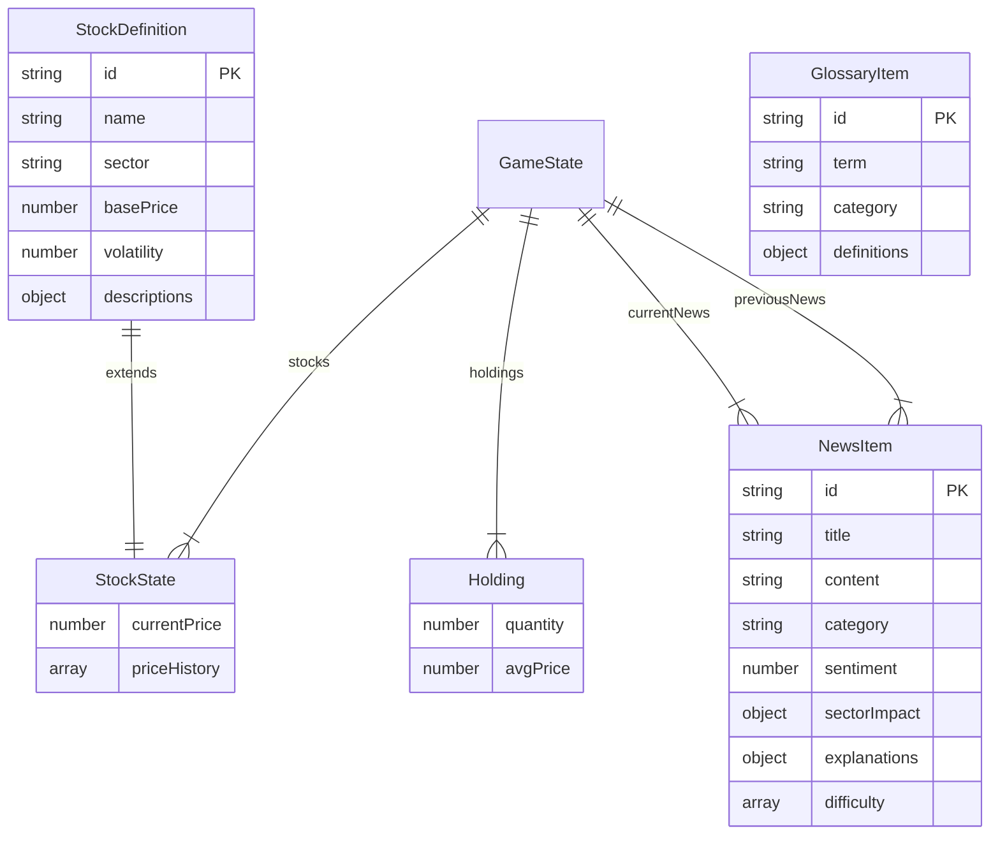

<div align="center">

# 📦 데이터 모델

**스탁스쿨 (StockSchool) — 인터페이스 & 데이터 구조 문서**

</div>

---

## 📑 목차

- [1. 데이터 모델 개요](#1--데이터-모델-개요)
- [2. StockDefinition](#2--stockdefinition)
- [3. StockState](#3--stockstate)
- [4. NewsItem](#4--newsitem)
- [5. GlossaryItem](#5--glossaryitem)
- [6. Holding](#6--holding)
- [7. GameState](#7--gamestate)
- [8. Firestore 문서 구조](#8--firestore-문서-구조)
- [9. 섹터 목록](#9--섹터-목록)
- [10. 전체 종목 목록](#10--전체-종목-목록)

---

## 1. 🗺️ 데이터 모델 개요



---

## 2. 📈 StockDefinition

> **파일:** `src/lib/stockData.ts`

종목의 기본 정보를 정의하는 인터페이스입니다.

```typescript
export interface StockDefinition {
  id: string;
  name: string;
  sector: SectorId;
  basePrice: number;
  volatility: number;
  exposure: 'export' | 'domestic' | 'mixed';
  descriptions: {
    elementary: string;
    middle: string;
    high: string;
  };
}
```

| 필드 | 타입 | 설명 | 예시 |
|:---|:---|:---|:---|
| `id` | `string` | 고유 식별자 (kebab-case) | `"nuri-elec"` |
| `name` | `string` | 한글 가상 기업명 | `"노바전자"` |
| `sector` | `SectorId` | 섹터명 `한글(English)` 형식 | `"기술(Tech)"` |
| `basePrice` | `number` | 기준가 (원) | `82000` |
| `volatility` | `number` | 변동성 계수 (0.5~1.7) | `0.7` |
| `exposure` | `enum` | 환율·거시 민감도 (`export` / `domestic` / `mixed`) | `"export"` |
| `descriptions` | `object` | 3단계 기업 설명 | - |
| ↳ `elementary` | `string` | 초등학생용 이야기형 설명 | - |
| ↳ `middle` | `string` | 중학생용 산업 분석 | - |
| ↳ `high` | `string` | 고등학생용 밸류에이션 분석 | - |

---

## 3. 📊 StockState

> **파일:** `src/stores/gameStore.ts`

런타임 주식 상태입니다. `StockDefinition`을 확장합니다.

```typescript
export interface StockState extends StockDefinition {
  currentPrice: number;
  priceHistory: number[];
}
```

| 필드 | 타입 | 설명 |
|:---|:---|:---|
| *(StockDefinition 전체)* | - | 기본 종목 정보 상속 |
| `currentPrice` | `number` | 현재 시뮬레이션 가격 |
| `priceHistory` | `number[]` | 일별 가격 기록 배열 |

---

## 4. 📰 NewsItem

> **파일:** `src/lib/types.ts`, `src/lib/newsData.ts`

```typescript
export interface NewsItem {
  id: string;
  title: string;
  content: string;
  category: 'macro' | 'sector' | 'company' | 'global' | 'social';
  sentiment: number;
  relatedSectors: SectorId[];
  sectorImpact: Partial<Record<SectorId, number>>;
  stockImpactOverrides?: Record<string, number>;
  explanations: { elementary: string; middle: string; high: string };
  difficulty: Level[];
  twistType?: NewsTwistType;
  readingHint?: Record<Level, string>;
  marketBias?: number;
  articleFormat?: 'breaking' | 'earnings' | 'interview' | 'rival' | 'policy' | 'trend';
  sourceDesk?: string;
  keyMetrics?: { label: string; value: string; note?: string }[];
  quote?: { text: string; speaker: string };
  relatedGlossaryIds?: string[];
}
```

| 필드 | 타입 | 설명 | 범위/예시 |
|:---|:---|:---|:---|
| `id` | `string` | 고유 식별자 | `"news-el-tech-pos"` |
| `title` / `content` | `string` | 비스포일러 헤드라인 / 본문 | - |
| `category` | `enum` | 카테고리 | `macro` / `sector` / `company` / `global` / `social` |
| `sentiment` | `number` | 감성 점수 | `-3` ~ `+3` (`0`은 혼조·중립) |
| `relatedSectors` | `SectorId[]` | 관련 섹터 (당일 UI 비공개, 다음 날 공개) | `["기술(Tech)"]` |
| `sectorImpact` | `Record` | 섹터별 영향도 | `{ "기술(Tech)": 0.08 }` |
| `stockImpactOverrides` | `Record` | 종목별 차별화 영향도 | `{ "flame-food": 0.06 }` |
| `articleFormat` / `sourceDesk` | `enum` / `string` | 6종 기사 포맷 / 가상 데스크 | `'earnings'`, `'공시·실적 분석팀'` |
| `keyMetrics` / `quote` | `array` / `object` | 핵심 수치 스냅샷 / 현장 인용구 | - |
| `relatedGlossaryIds` | `string[]` | 본문 연동 금융 용어 ID | `["g-19", "g-20"]` |

### 감성 점수 (Sentiment)

| 값 | 의미 | 레이블 |
|:---:|:---:|:---|
| +3 / +2 / +1 | 강한 호재 ~ 호재 | 🟢 호재 |
| 0 | 섹터 혼조 · 중립 | ⚖️ 혼조 |
| -1 / -2 / -3 | 악재 ~ 강한 악재 | 🔴 악재 |

---

## 5. 📚 GlossaryItem

> **파일:** `src/lib/glossaryData.ts` & `src/lib/glossary/*` (6개 카테고리 · 총 80개 용어)

```typescript
export type GlossaryCategory =
  | 'basic'
  | 'financial'
  | 'market'
  | 'macro'
  | 'sector'
  | 'advanced';

export interface GlossaryItem {
  id: string;
  term: string;
  category: GlossaryCategory;
  shortSummary: Record<Level, string>;
  definitions: Record<Level, string>;
  examples: Record<Level, string>;
  relatedIds: string[];
  relatedSectors?: SectorId[];
  keywords?: string[];
}
```

| 카테고리 | 레이블 | 수량 | 주요 포함 용어 (총 80개) |
|:---:|:---|:---:|:---|
| `basic` | 주식 기초·거래 | 18 | 주식, 시가총액, 배당금, 거래량, 유동성, 블루칩, 분산투자, 자사주 소각, 액면분할, 매수·매도·체결, 호가창, 시가·종가·상한가, 코스피·코스닥, ETF, IPO, 포트폴리오·리밸런싱, 성장주·가치주, 경기민감·방어주 |
| `financial` | 재무·실적 분석 | 15 | PER, PBR, ROE, 컨센서스, 어닝 서프라이즈/쇼크, CapEx, 매출·영업이익·순이익, 영업이익률(OPM), EPS·BPS, 잉여현금흐름(FCF), 가이던스, 밸류에이션·리레이팅, 배당수익률·배당락, TSR, EV/EBITDA |
| `market` | 차트·시장 심리 | 9 | 이동평균선, 변동성, 캔들차트(양봉·음봉), 지지선·저항선, 골든·데드크로스, 선반영·차익실현, 호재·악재, 수급(외국인·기관·개인), 손절·익절·분할매수 |
| `macro` | 거시경제·정책 | 15 | 기준금리, 인플레이션, GDP, 양적완화(QE), 환율, 밸류업·저PBR, 안전자산 선호(Risk-Off), CPI·PPI, 채권·국채, 경기침체·연착륙·경착륙, 스태그플레이션·디플레이션, 긴축(QT)·피벗, 관세·공급망, 무역수지, SOC |
| `sector` | 산업 핵심 지표 | 15 | NIM, 수주잔고, 정제마진, CDMO, 가동률·수율·증설·감산, 산업 사이클·피크아웃, ASP·스프레드, HBM, 임상·파이프라인·바이오시밀러, OEM·ODM, SCFI·BDI, 신조선가·후판, MAU·GMV·ARPU·잠금효과, 부동산 PF·대손충당금, CET1·CSM·K-ICS |
| `advanced` | 기업 이벤트·심화 | 8 | 공매도, 래깅 효과, 물적분할·중복상장, CB·오버행, 유상·무상증자, 지배구조·주총·의결권, 지주사 할인·NAV, DCF·WACC·헤지 |

---

## 6. 💼 Holding

```typescript
export interface Holding {
  quantity: number;
  avgPrice: number;
  totalCost?: number;
}
```

| 필드 | 타입 | 설명 |
|:---|:---|:---|
| `quantity` | `number` | 보유 수량 (주) |
| `avgPrice` | `number` | 평균 매수 가격 (원, 표시용 반올림) |
| `totalCost` | `number` | 정확한 누적 매입 원가 (원, 분할 매매 반올림 드리프트 방지) |

---

## 7. 🎮 GameState

> **파일:** `src/stores/gameStore.ts`

```typescript
interface GameState {
  // 인증 및 동기화 상태
  authMode: 'guest' | 'google' | null;
  uid: string | null;
  displayName: string | null;
  isLoadingState: boolean;
  loadStatus: 'idle' | 'loading' | 'ready' | 'error';
  loadError: string | null;
  isSaving: boolean;
  saveError: string | null;
  lastSavedAt: string | null;

  // 게임 진행
  level: 'elementary' | 'middle' | 'high';
  dayCount: number;
  cash: number;
  initialCash: number;
  revision: number;

  // 시장 데이터
  stocks: Record<string, StockState>;
  currentNews: NewsItem[];
  previousNews: NewsItem[];
  usedNewsIds: string[];

  // 포트폴리오 및 체결 원장
  holdings: Record<string, Holding>;
  totalAssetHistory: number[];
  tradeHistory: TradeRecord[];
  tradeStats: TradeStats;
  realizedProfitTotal: number;

  // UI (비영속)
  theme: 'light' | 'dark';
  tutorialStep: number | null;
}
```

---

## 8. 🗄️ Firestore 문서 구조 (v2 경량 압축 스키마)

```
📁 users (Collection)
└── 📄 {uid} (Document)
      ├── schemaVersion: 2
      ├── displayName: string | null (최대 80자)
      ├── currentLevel: 'elementary' | 'middle' | 'high'
      ├── updatedAt: string (ISO 8601)
      └── gameStates: map
            └── {level}: CompactLevelSave
                  ├── schemaVersion: 2
                  ├── revision: number (동시성 충돌 감지용 단조 증가)
                  ├── level: Level
                  ├── dayCount: number
                  ├── cash: number
                  ├── initialCash: number
                  ├── stocks: map ({ currentPrice, pricesCsv, volumesCsv })
                  ├── holdings: map ({ quantity, avgPrice, totalCost })
                  ├── currentNewsIds: string[]
                  ├── previousNewsIds: string[]
                  ├── usedNewsIdsCsv: string
                  ├── totalAssetHistoryCsv: string
                  ├── tradeHistoryJson: string (최근 200건)
                  ├── tradeStats: TradeStats
                  └── realizedProfitTotal: number
```

---

## 9. 🏭 섹터 목록 (17개 산업 × 2종목 = 34종목)

| # | 섹터 코드 | 한글명 | 종목 수 |
|:---:|:---|:---|:---:|
| 1 | `기술(Tech)` | 기술 | 2 |
| 2 | `자동차(Auto)` | 자동차 | 2 |
| 3 | `배터리(Battery)` | 배터리 | 2 |
| 4 | `정유/에너지(Energy)` | 정유/에너지 | 2 |
| 5 | `인터넷(Internet)` | 인터넷 | 2 |
| 6 | `금융(Finance)` | 금융 | 2 |
| 7 | `바이오(Bio)` | 바이오 | 2 |
| 8 | `방산/우주(Defense)` | 방산/우주 | 2 |
| 9 | `식품(Food)` | 식품 | 2 |
| 10 | `화학(Chemical)` | 화학 | 2 |
| 11 | `소재(Material)` | 소재 | 2 |
| 12 | `통신(Telecom)` | 통신 | 2 |
| 13 | `조선(Shipbuilding)` | 조선 | 2 |
| 14 | `건설(Construction)` | 건설 | 2 |
| 15 | `화장품(Cosmetics)` | 화장품 | 2 |
| 16 | `지주(Holding)` | 지주 | 2 |
| 17 | `해운(Shipping)` | 해운 | 2 |

---

## 10. 📋 전체 가상 종목 목록 (34개사)

| # | ID | 가상 종목명 | 섹터 | 기준가(₩) | 변동성 | 구조 |
|:---:|:---|:---|:---|---:|:---:|:---:|
| 1 | `nuri-elec` | 노바전자 | 기술(Tech) | 82,000 | 0.7 | export |
| 2 | `neo-memory` | 뉴로세미 | 기술(Tech) | 195,000 | 1.3 | export |
| 3 | `baram-motors` | 루시온모터스 | 자동차(Auto) | 240,000 | 0.9 | export |
| 4 | `mobil-parts` | 오토코어 | 자동차(Auto) | 145,000 | 1.0 | export |
| 5 | `powercell-energy` | 볼트엑스 | 배터리(Battery) | 340,000 | 1.4 | export |
| 6 | `solid-battery` | 아이온셀 | 배터리(Battery) | 280,000 | 1.2 | export |
| 7 | `haeorum-oil` | 넥소일 | 정유/에너지(Energy) | 76,000 | 1.4 | mixed |
| 8 | `clear-power` | 에너그리드 | 정유/에너지(Energy) | 54,000 | 0.9 | domestic |
| 9 | `open-portal` | 플로우넷 | 인터넷(Internet) | 210,000 | 1.1 | domestic |
| 10 | `damoa-platform` | 웨이브톡 | 인터넷(Internet) | 62,000 | 1.3 | domestic |
| 11 | `ansim-finance` | 피넥스금융 | 금융(Finance) | 84,000 | 0.6 | domestic |
| 12 | `dundeun-life` | 라이프온생명 | 금융(Finance) | 88,000 | 0.5 | domestic |
| 13 | `medi-factory` | 셀로직스 | 바이오(Bio) | 640,000 | 1.0 | export |
| 14 | `cure-bio` | 큐어젠바이오 | 바이오(Bio) | 185,000 | 1.3 | export |
| 15 | `guardian-aero` | 에어로엑스 | 방산/우주(Defense) | 230,000 | 1.4 | export |
| 16 | `starlight-defense` | 오르빗테크 | 방산/우주(Defense) | 118,000 | 1.3 | export |
| 17 | `flame-food` | 스파이스랩 | 식품(Food) | 310,000 | 1.5 | export |
| 18 | `family-food` | 하베스트푸드 | 식품(Food) | 175,000 | 0.8 | domestic |
| 19 | `pureun-chem` | 에코케미컬 | 화학(Chemical) | 220,000 | 1.1 | mixed |
| 20 | `next-materials` | 하이켐소재 | 화학(Chemical) | 265,000 | 1.5 | export |
| 21 | `gangcheol-ind` | 네오스틸 | 소재(Material) | 295,000 | 1.3 | export |
| 22 | `terra-mineral` | 테라메탈 | 소재(Material) | 158,000 | 1.5 | mixed |
| 23 | `onnuri-telecom` | 원텔레콤 | 통신(Telecom) | 52,000 | 0.5 | domestic |
| 24 | `ieum-network` | 파이버넷 | 통신(Telecom) | 41,000 | 0.6 | domestic |
| 25 | `ocean-shipbuilding` | 아틀라스조선 | 조선(Shipbuilding) | 138,000 | 1.4 | export |
| 26 | `pado-heavy` | 마린파워 | 조선(Shipbuilding) | 96,000 | 1.3 | export |
| 27 | `smart-const` | 아크이앤씨 | 건설(Construction) | 44,000 | 1.2 | mixed |
| 28 | `urban-infra` | 어반인프라 | 건설(Construction) | 36,000 | 1.1 | domestic |
| 29 | `lumina-beauty` | 루미나뷰티 | 화장품(Cosmetics) | 152,000 | 1.3 | export |
| 30 | `pure-cosmetic` | 코스메랩 | 화장품(Cosmetics) | 89,000 | 1.1 | export |
| 31 | `daon-holdings` | 버텍스홀딩스 | 지주(Holding) | 148,000 | 0.9 | domestic |
| 32 | `gaon-group` | 브릿지홀딩스 | 지주(Holding) | 92,000 | 0.8 | domestic |
| 33 | `bluewave-shipping` | 퍼시픽라인 | 해운(Shipping) | 22,000 | 1.7 | export |
| 34 | `bada-logistics` | 오션로지스 | 해운(Shipping) | 31,000 | 1.4 | export |

---

<div align="center">

[⬆️ 맨 위로](#-데이터-모델) • [📐 아키텍처](./ARCHITECTURE.md) • [📖 README](../README.md)

</div>
