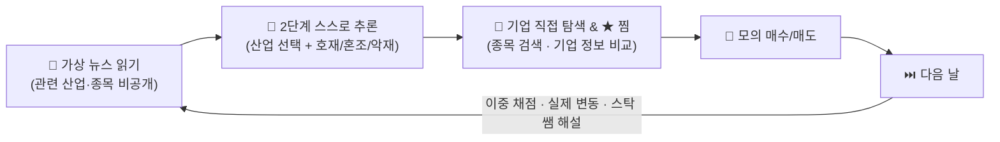
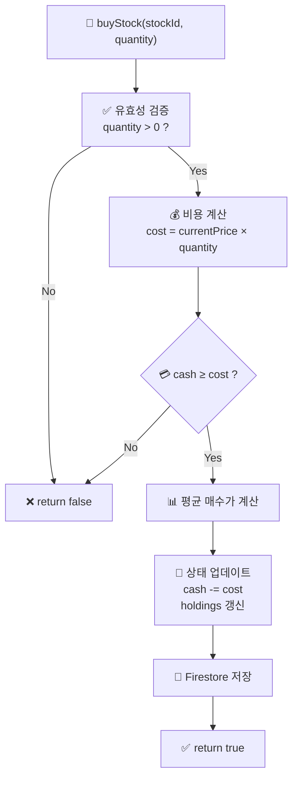
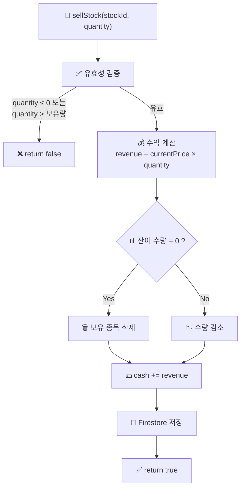
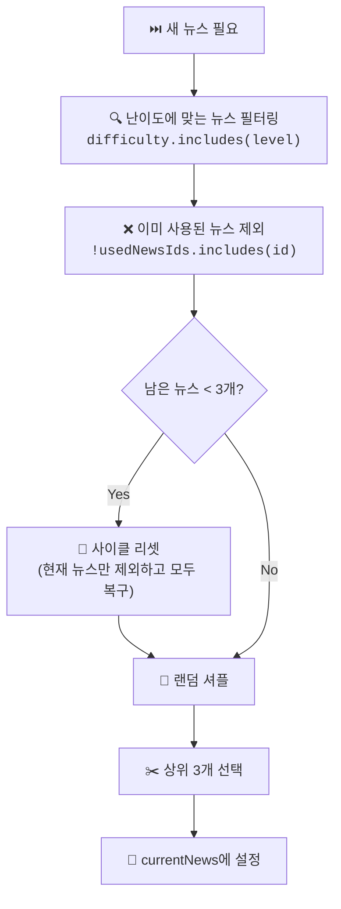
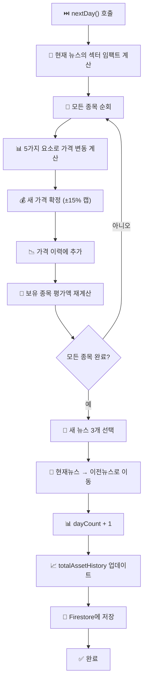

<div align="center">

# 🎲 게임 메카닉스

**스탁스쿨 (StockSchool) — 게임 로직 & 시뮬레이션 엔진 문서**

<p>
  
  
  
</p>

</div>

---

## 📑 목차

- [1. 게임 개요](#1--게임-개요)
- [2. 난이도 시스템](#2--난이도-시스템)
- [3. 주가 시뮬레이션 알고리즘](#3--주가-시뮬레이션-알고리즘)
- [4. 매매 시스템](#4--매매-시스템)
- [5. 뉴스 시스템](#5--뉴스-시스템)
- [6. 포트폴리오 관리](#6--포트폴리오-관리)
- [7. 일(Day) 진행 시스템](#7--일day-진행-시스템)

---

## 1. 🎮 게임 개요

스탁스쿨의 학습 루프는 **일(Day) 단위**로 진행되며, 모든 종목과 뉴스는 100% 창작된 가상 교육 데이터입니다. 당일 화면에서는 관련 산업·종목을 미리 알려주지 않고 **학생 스스로 기사를 읽고 영향 산업과 방향을 추론**하도록 설계되어 있습니다.



### 학습 목표

> 💡 **실제 돈이 오가지 않는 가상 자금으로 뉴스 독해(문해력), 산업 인과관계 추론(경제 문해력), 분산투자 원리를 안전하게 학습합니다.**

---

## 2. 🎓 난이도 시스템

### 난이도별 비교표

| 항목 | 🟢 초급 (`elementary`) | 🟡 중급 (`middle`) | 🔴 고급 (`high`) |
|:---|:---:|:---:|:---:|
| **초기 가상 자금** | ₩1,000,000 | ₩5,000,000 | ₩10,000,000 |
| **뉴스 풀 (시나리오 포함)** | 366편 (단독260 + 30시나리오106화) | 366편 (단독260 + 30시나리오106화) | 366편 (복합·환율 차별화 포함) |
| **산업 추론 보기** | 6개 보기 중 1~3개 선택 | 17개 전체 산업 중 1~3개 선택 | 17개 전체 산업 중 1~3개 선택 |
| **뉴스 반영 배수 (`newsScale`)** | ×0.65 | ×0.52 | ×0.45 |
| **랜덤 노이즈 (`× volatility`)** | ±0.9% | ±1.5% | ±2.0% |
| **돌발 수급 충격** | 없음 (0%) | 3.0% (사유 배지 표시) | 4.5% (사유 배지 표시) |
| **전일 뉴스 이월 모멘텀** | 없음 | 없음 | 25% 이월 |
| **동일 섹터 상반 뉴스 충돌 방지** | ✅ 적용 | ✅ 적용 | 복합 혼조 허용 |

---

## 3. 📈 주가 시뮬레이션 알고리즘 (`src/lib/priceEngine.ts`)

### 핵심 공식

매일(`nextDay()`) 호출 시 [`simulateNextDay`](../src/lib/priceEngine.ts)가 각 종목의 가격을 계산합니다:

```
totalChange = newsContribution + carryoverContribution + marketAndNoise + shockContribution
              (뉴스 기여분)       (전일 이월, 고급)      (시장+랜덤+회귀)    (돌발 수급)

단, totalChange는 [-0.15, +0.15] 범위로 제한 (일일 최대 ±15%)
새 가격 = roundToTickSize(현재가 × (1 + totalChange))  // 한국 거래소 호가 단위 반올림
```

### 핵심 개선 사항 (v2.0)

1. **수출형 vs 내수형 종목별 예외(`stockImpactOverrides`)**: 고환율 뉴스 시 같은 식품 섹터 내에서도 수출형 `불꽃푸드`는 상승(+), 수입 원가 비중이 높은 `온가족식품`은 하락(-)으로 차별화됩니다.
2. **표시 수치와 실제 반영 일치**: `어제 뉴스 해설` 탭에 난이도별 `newsScale`이 적용된 뉴스 반영 강도와 각 종목의 **실제 전일 등락률 및 돌발 수급 사유**를 함께 공개합니다.
3. **결정론적 거래량 연동**: 거래량(`volumeHistory`)은 `nextDay()` 시점에 가격 변동폭과 뉴스 유무에 비례하여 계산·저장되므로 차트 리렌더 시에도 일관되게 유지됩니다.
4. **KRX 호가 단위 반올림**: 가격대별 호가 단위(5원/10원/50원/100원/500원/1,000원)를 적용해 현실적인 가격과 모의 호가창을 제공합니다.

---

## 4. 🛒 매매 시스템

### 매수 (Buy)



**평균 매수가 계산 공식:**

```
새 평균 매수가 = (기존수량 × 기존평균가 + 추가비용) / 총 수량
```

```typescript
const newQuantity = currentHolding.quantity + quantity;
const newTotalCost = (currentHolding.quantity * currentHolding.avgPrice) + cost;
const newAvgPrice = Math.round(newTotalCost / newQuantity);
```

### 매도 (Sell)



---

## 5. 📰 뉴스 시스템

### 뉴스 데이터 구조

| 필드 | 타입 | 설명 |
|:---|:---|:---|
| `id` | string | 고유 식별자 (예: `news-el-1`) |
| `title` | string | 뉴스 헤드라인 |
| `content` | string | 뉴스 본문 (상세 기사) |
| `category` | enum | `macro` / `sector` / `company` / `global` |
| `sentiment` | number | -2(매우 악재) ~ +2(매우 호재) |
| `sectorImpact` | Record | 섹터별 영향도 (예: `{ "기술(Tech)": 0.08 }`) |
| `explanations` | object | 3단계 AI 해설 |
| `difficulty` | string[] | 표시 대상 레벨 |

### 뉴스 선택 알고리즘



### 뉴스 카테고리

| 카테고리 | 레이블 | 설명 |
|:---:|:---|:---|
| `macro` | 🌍 거시경제 | 금리, 환율, GDP 등 거시 변수 |
| `sector` | 🏭 산업/경제 | 특정 산업 동향 |
| `company` | 🏢 기업/종목 | 개별 기업 이슈 |
| `global` | 🌐 글로벌 | 국제 정세, 해외 시장 |

### 뉴스 → 주가 영향 흐름

```
뉴스 A: { sectorImpact: { "기술(Tech)": 0.08, "에너지(Energy)": -0.04 } }
뉴스 B: { sectorImpact: { "기술(Tech)": 0.03 } }
뉴스 C: { sectorImpact: { "자동차(Auto)": 0.06 } }

→ 섹터별 임팩트 합산:
  기술(Tech): 0.08 + 0.03 = 0.11  →  × 0.3  = 0.033 (+3.3%)
  에너지(Energy): -0.04            →  × 0.3  = -0.012 (-1.2%)
  자동차(Auto): 0.06               →  × 0.3  = 0.018 (+1.8%)
```

---

## 6. 💼 포트폴리오 관리

### 자산 계산

```
총 자산 = 보유 현금 + Σ(종목별 현재가 × 보유 수량)
수익률 = ((총 자산 - 초기 자금) / 초기 자금) × 100%
```

### 종목별 손익 계산

```
평가 금액 = 현재가 × 보유 수량
매입 금액 = 평균 매수가 × 보유 수량
평가 손익 = 평가 금액 - 매입 금액
수익률 = ((현재가 - 평균 매수가) / 평균 매수가) × 100%
```

### 자산 이력 추적

매일 `nextDay()` 호출 시 `totalAssetHistory` 배열에 현재 총 자산을 기록합니다:

```typescript
totalAssetHistory: [...totalAssetHistory, cash + totalStockValue]
```

---

## 7. ⏭️ 일(Day) 진행 시스템

### nextDay() 전체 흐름



---

<div align="center">

[⬆️ 맨 위로](#-게임-메카닉스) • [📐 아키텍처](./ARCHITECTURE.md) • [📖 README](../README.md)

</div>
